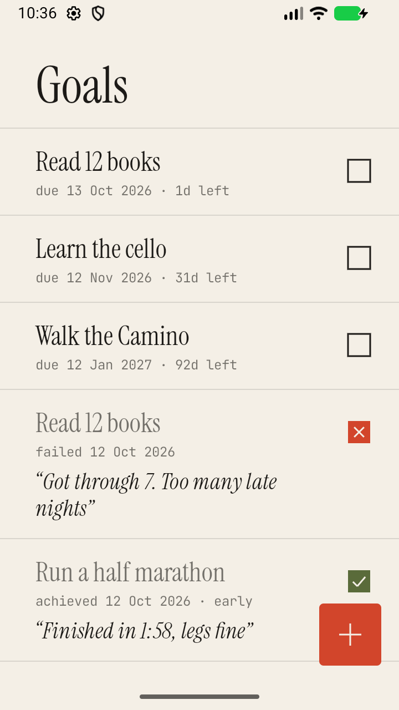
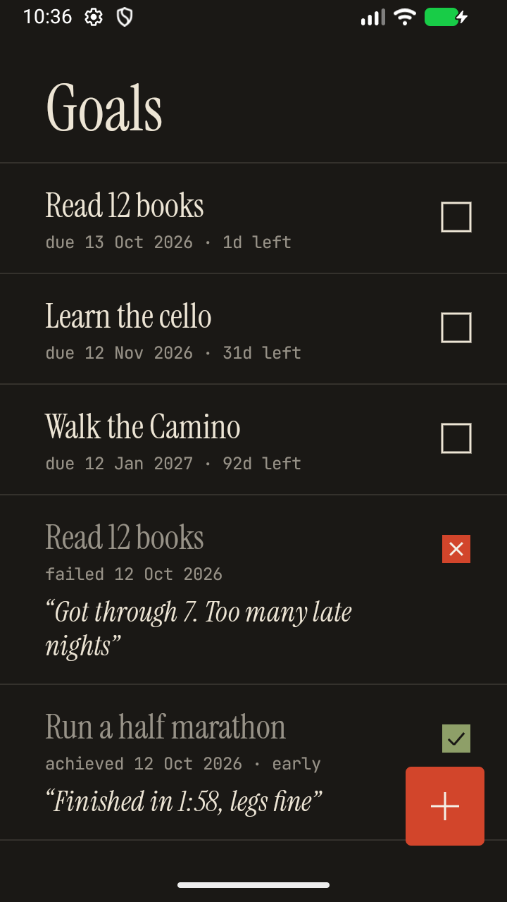
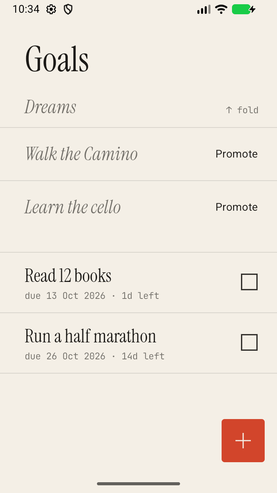

# Remember Goals

A small Android goal journal. Write a goal down with a deadline, tick it off when it's done, and say a few words about
how it went. Goals without a deadline are dreams: they wait, folded away above the list, until you give them one.

<p>
  
  
  
</p>

## What it does

- **One screen**: a ledger of goals, newest on top. The `+` button opens "New goal": a name (required), an optional
  duration (a number of days, weeks or months) and an optional description.
- **Dreams**: save a goal without a duration and it becomes a dream. Dreams are hidden above the list; pull the list
  down (or tap `↓ N dreams`) to reveal them. **Promote** a dream by giving it a duration, and it joins the ledger.
- **Closing a goal**: tap its box and choose *Achieved* or *Not achieved*. A short note is required either way. Achieved
  goals get an olive check and the date you ticked them (`· early` if before the deadline). Failed goals get a red X.
- **Set again**: after a fail the app asks whether to try again. Yes adds a new goal with the same duration, starting
  today. The failed entry stays in the ledger as it was.
- **Reminders**: a notification one day before the deadline and one at the deadline, each with *Achieved* / *Not
  achieved* buttons that open the same note sheet. If notifications are blocked, a faint "reminders are off" line
  links to the system settings.

Everything is stored on the device (Room / SQLite). No account, no network.

## Build and run

Requirements: JDK 17 and the Android SDK (compileSdk 37). No Gradle install needed.

```sh
JAVA_HOME=/path/to/jdk17 ./gradlew assembleDebug            # app/build/outputs/apk/debug/app-debug.apk
JAVA_HOME=/path/to/jdk17 ./gradlew testDebugUnitTest lintDebug
adb install -r app/build/outputs/apk/debug/app-debug.apk
```

minSdk 26 (Android 8.0). On Android 13+ the app asks for notification permission on first launch; it works without it.

## Tech stack

- Kotlin, Jetpack Compose, Material 3 (heavily restyled)
- Room (KSP) with Flow for storage, one `Goal` table (a dream is a row with no deadline)
- WorkManager for the two reminders per goal
- One activity, one ViewModel that talks to the DAO directly. No DI, no repository layer, no navigation library.

Code lives flat in `app/src/main/java/com/bolsar/remembergoals/`: `Goal.kt` (entity, deadline math), `AppDb.kt`
(DAO + database), `GoalsViewModel.kt`, `GoalsScreen.kt` (all UI), `Reminders.kt` (scheduling + notification worker),
`MainActivity.kt`. Development notes and decisions are in [`docs/PROGRESS.md`](docs/PROGRESS.md).

## Design notes

The app is meant to feel like a paper ledger, not a stock Material app:

- Warm paper and ink colors (charcoal paper and cream ink in dark mode), no dynamic color, no shadows, no cards.
- One accent, vermilion, used only for the add button and failed goals. Achieved goals are olive.
- Rows are separated by hairline rules, with a wide notebook margin on the left.
- Instrument Serif for titles, JetBrains Mono for dates and countdowns, the platform sans for everything else.
- The tick boxes, the `+` and the launcher icon are drawn by hand (Canvas / vector), not taken from an icon set.

## Licenses

The bundled fonts, [Instrument Serif](https://github.com/Instrument/instrument-serif) and
[JetBrains Mono](https://github.com/JetBrains/JetBrainsMono), are licensed under the SIL Open Font License 1.1. See
[`LICENSES/OFL-1.1.txt`](LICENSES/OFL-1.1.txt).
