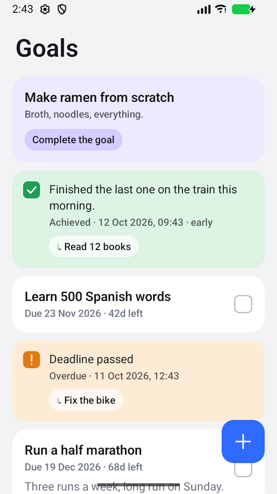
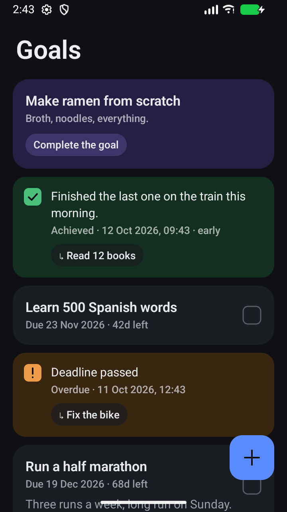
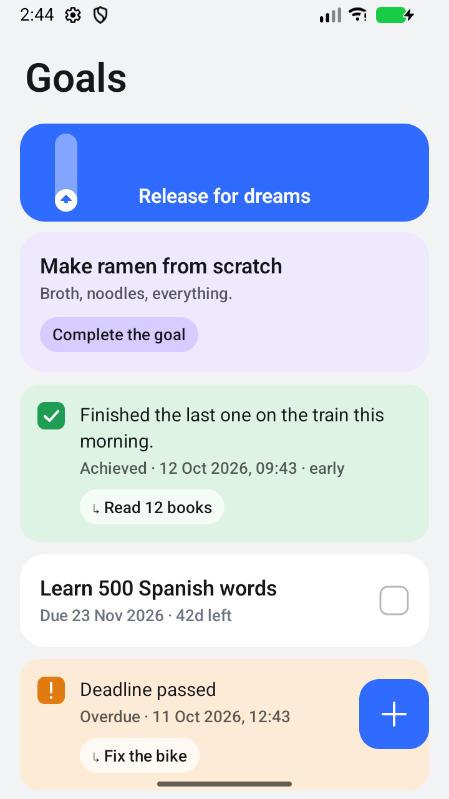
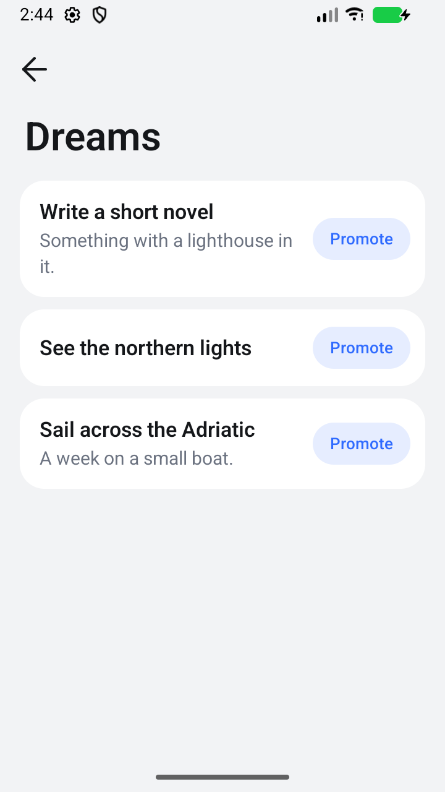

# Remember Goals

A small Android goal journal. Write a goal down with a deadline, tick it off when it's done, and say a few words about
how it went. Goals without a deadline are dreams. They wait in a Telegram-style archive above the list until you give
them one.

<p>
  
  
  
  
</p>

## What it does

- **Goals list**: one card per goal, newest on top. A card never moves once it's there. Its colour follows the goal:
  green when achieved, red when not, orange when the deadline has passed and it is still open.
- **Event rows**: when a goal is achieved, not achieved or goes overdue, a small card is added on top. It shows a
  ticked box, the note (or "Deadline passed"), the date and time, and a chip `↳ <goal>`. Tap the chip to scroll down to
  the goal card, which pulses briefly. An overdue goal can still be closed later, and that adds another event row.
- **Add Goal page**: `+` opens a full page with a name (required), an optional duration (a number of days, weeks or
  months) and an optional description. Tap **Add** to save it.
- **Drafts**: leave the page without tapping Add (back arrow, system back, or just switching away from the app) and
  whatever you typed is kept as a purple draft card marked "Complete the goal". Tap it to reopen the page prefilled.
  Add turns it into a goal or a dream in place. Empty every field and leave to discard it.
- **Editing**: tap an open goal's card to reopen the same page as "Edit goal": name, duration and description. The
  start date stays, so the card keeps its place and the deadline is counted from that start. **Save** applies the
  changes and moves the reminders; back discards them. Closed goals (achieved / not achieved) are final.
- **Dreams**: a goal added without a duration is a dream. Dreams sit in an "archived chats" row, like Telegram's:
  - The row starts hidden. Pull the list down at the top to reveal it. Past the snap point the arrow flips and the
    accent fills the row. Let go there and the row stays out.
  - Swipe the row left to pin it in the list. Swipe a pinned row left to hide it again.
  - Tap the row to open the Dreams page. **Promote** a dream by giving it a duration, and it becomes a goal.
  - With no dreams, the row doesn't exist.
  - TalkBack users get "Show dreams" on the list and "Pin in the list" / "Hide above the list" on the row.
- **Closing a goal**: tap its box and choose *Achieved* or *Not achieved*. A short note is required either way.
  Achieving it before the deadline is marked `· early`. After a miss the app asks "Set this goal again?". Yes adds a
  new goal with the same duration, starting today, and the missed one stays as it was.
- **Reminders**: one notification a day before the deadline and one at the deadline. Each has *Achieved* / *Not
  achieved* buttons that open the same note sheet. If notifications are blocked, a "Reminders are off" line links to
  the system settings.

Everything is stored on the device (Room / SQLite). No account, no network.

## Build and run

Requirements: JDK 17 and the Android SDK (compileSdk 37). No Gradle install needed.

```sh
JAVA_HOME=/path/to/jdk17 ./gradlew assembleDebug            # app/build/outputs/apk/debug/app-debug.apk
JAVA_HOME=/path/to/jdk17 ./gradlew testDebugUnitTest lintDebug
adb install -r app/build/outputs/apk/debug/app-debug.apk
```

minSdk 26 (Android 8.0). On Android 13+ the app asks for notification permission on first launch. It works without it.

## Tech stack

- Kotlin, Jetpack Compose, Material 3 (fully restyled, no dynamic colour)
- Room (KSP) with Flow for storage. There is one `Goal` table: a dream is a row with no deadline, a draft is a row
  with `draft = 1`. Event rows are not stored; they are derived from each goal's deadline and resolution.
- WorkManager for the two reminders per goal
- One activity and one ViewModel that talks to the DAO directly. No DI, no repository layer, no navigation library.

Code lives flat in `app/src/main/java/com/bolsar/remembergoals/`:

- `Goal.kt`: entity, deadline math, the page → row logic, and `timeline()` (cards + derived events)
- `AppDb.kt`: DAO, database, migration
- `GoalsViewModel.kt`
- `GoalsScreen.kt`: the list, cards, Add Goal page, Dreams page and sheets
- `Archive.kt`: the Telegram archive row (pull, pin, swipe, drawing)
- `Reminders.kt`: scheduling and the notification worker
- `MainActivity.kt`

Development notes and decisions are in [`docs/PROGRESS.md`](docs/PROGRESS.md).

## Design notes

- Soft rounded cards (20dp corners, 16dp gutter, flat tonal surfaces, no shadows) on a light grey or near-black
  background. One blue accent for the `+` button, buttons, links and the archive. No dynamic colour.
- Each status has a soft surface and a strong colour: green achieved, red not achieved, orange overdue, purple draft.
  Muted text on tinted cards is ink at 70%, so it keeps AA contrast.
- Platform sans only, with chosen weights: a 32sp SemiBold screen title, 17sp SemiBold card titles, 13sp Medium meta.
- Motion is spring-based. List items fade and slide into place, surfaces cross-fade, and the tick box's check strokes
  in. The Add Goal and Dreams pages slide up over the list, and the `+` button scales out and back in.
- The dreams archive copies Telegram Android's pull drawable: the 0.85 snap point, the parallax and rubber band, and
  the timings and easing curves. The numbers are in `Archive.kt` and `docs/PROGRESS.md`.
- The app icon is the tick box: a white rounded square with a rounded check on the accent blue. It is adaptive, with a
  monochrome layer for themed icons.
